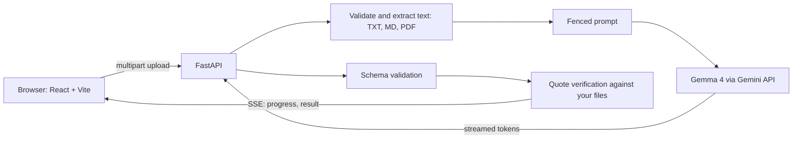

# Proof2Motion

**Live demo:** _paste your Cloudways URL here after deploying_ &nbsp;|&nbsp; **Licence:** MIT &nbsp;|&nbsp; **Model:** Gemma 4 (open weights)

> Edit this paragraph to match the official hackathon problem statement.

People make claims that the documents in front of them do not actually prove, and explaining a case clearly takes hours.
**Proof2Motion** reads your evidence (TXT, MD, PDF), shows which claims it really supports, lists what is missing,
and turns the story into a five-scene storyboard you can play like a short explainer video.

Its key idea is **verifiable AI**: every quote the model returns is re-checked, word for word, against your files.
Invented quotes are flagged and unproven claims are downgraded, so you never see "proof" that is not in your documents.

## Features
- Live analysis: you watch Gemma 4 work (streamed over Server-Sent Events)
- Claims marked supported / partly supported / not supported, with highlighted quotes and PDF page numbers
- Server-side quote verification and automatic downgrade of unproven claims
- Gaps and contradictions list, five-scene playable storyboard, JSON export
- Offline demo mode that needs no API key (a safety net for live presentations)
- Secure by default: upload limits, rate limiting, security headers, schema-validated AI output (see [SECURITY.md](SECURITY.md))

## Architecture

```
backend/app/   config, security, extract, prompts, llm, schemas, verify, main
backend/tests/ 17 automated tests (security, verification, streaming)
frontend/      React app (src/), prebuilt in dist/
deploy/        cloudways_setup.sh
Dockerfile     one-image deploy (DigitalOcean App Platform, Cloudways Docker, any VPS)
```

## Run it locally (3 minutes)
Needs Python 3.10+ and a free key from https://aistudio.google.com/apikey

- **Windows:** double-click `start.bat`. **Mac/Linux:** `./start.sh`
- First run creates `backend/.env`. Paste your key after `GEMINI_API_KEY=`, save, run the script again.
- Open **http://localhost:8000**, click *Use the sample water-complaint file*, then *Analyze evidence*.

Node.js is not needed: the built frontend is included. To change the UI: `cd frontend && npm install && npm run dev`
(http://localhost:5173), then `npm run build`.

## Tests
```
cd backend
pip install -r requirements-dev.txt
python -m pytest
```

## Hacktoberfest 2026 categories
| Category | How this project qualifies |
| --- | --- |
| **Best Use of Gemma 4** | `gemma-4-31b-it` does all analysis, streamed live (`backend/app/llm.py`). Fallbacks (`gemma-4-26b-a4b-it`, then `gemini-2.5-flash`) run only if Gemma is unavailable. |
| **Best Open-Source AI Project** (DigitalOcean) | Open-weights model at the core of the product, MIT licence, runs on a plain Python server or the included Dockerfile. |
| **Best Use of Graphify** | The codebase is mapped with Graphify (`graphify-out/`). See below. |
| **Best Use of Cloudways** | Deployed and running on Cloudways with `deploy/cloudways_setup.sh`. See below. |

### Graphify
```
pip install graphifyy
graphify . --code-only
```
Writes `graphify-out/` (knowledge graph). Commit it and add a screenshot or the generated report here.

### Deploy on Cloudways
1. In Cloudways create a server (DigitalOcean provider) with a Custom App, and enable SSH.
2. Upload this project (git clone or SFTP), then over SSH: `bash deploy/cloudways_setup.sh`
3. Edit `backend/.env` (add `GEMINI_API_KEY`), run the script again. It starts the app on port 8000 and checks `/api/health`.
4. Open TCP port 8000 in the Cloudways firewall, or ask Cloudways support to proxy your app domain to port 8000 so you get HTTPS.
5. Paste the public URL at the top of this README.

### Deploy with Docker (DigitalOcean App Platform or any server)
```
docker build -t proof2motion .
docker run -p 8000:8000 -e GEMINI_API_KEY=your_key proof2motion
```

## Limits
- Text-based PDFs only (scanned images contain no text to read). Files are trimmed to the first 12,000 characters.
- AI can still misread evidence. Verification proves a quote exists in your files, not that the interpretation is right.
- Uploaded text is sent to the Gemini API. Do not upload confidential documents.

## Roadmap
OCR for scanned PDFs, exporting the storyboard as video, multi-language evidence, user accounts and shared cases.
